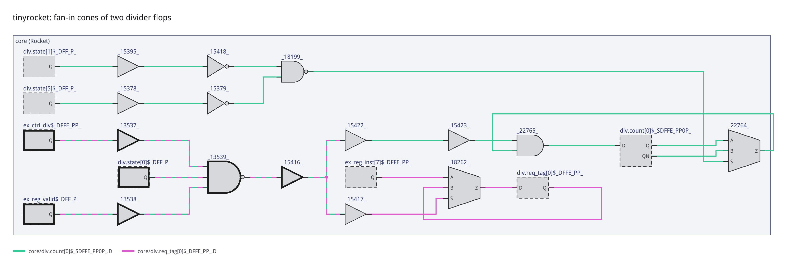

# naja-schematic

[](https://github.com/keplertech/naja-schematic/actions/workflows/native-macos.yml)
[](https://github.com/keplertech/naja-schematic/actions/workflows/native-linux.yml)
[](https://github.com/keplertech/naja-schematic/actions/workflows/emscripten.yml)
[](https://codecov.io/gh/keplertech/naja-schematic)
[](https://colab.research.google.com/github/keplertech/naja-schematic/blob/main/python/notebooks/getting_started.ipynb)

An interactive schematic viewer for netlists loaded with
[naja](https://github.com/najaeda/naja): browse the design hierarchy, trace
a signal back to its drivers, and jump from any gate to the source line it
came from. It runs as a desktop app (macOS, Linux), in a browser, or inside
a Jupyter/Colab/VSCode notebook.

> **Note:** This is a beta. Expect rough edges and breaking changes.


## Quick start

**In a notebook**: no install needed, [open the getting-started notebook
in Colab](https://colab.research.google.com/github/keplertech/naja-schematic/blob/main/python/notebooks/getting_started.ipynb),
then try [a real RISC-V core](https://colab.research.google.com/github/keplertech/naja-schematic/blob/main/python/notebooks/tinyrocket.ipynb).
Locally:

```bash
pip install naja-schematic
```

```python
from najaeda import netlist
import naja_schematic

netlist.load_liberty("cells.lib")
netlist.load_gate_level_verilog("design.v")
naja_schematic.show()          # the viewer, in the cell output
```

**In a browser**, from a shell (same `pip install`):

```bash
naja-schematic --verilog design.v --liberty cells.lib --open
```

**As a desktop app**: [build it](#building-from-source), then:

```bash
naja-schematic-standalone design.v --liberty cells.lib
```

See the [Python package README](python/README.md) for the notebook API
(diagnosis overlays, selecting instances from code, embedding the viewer in
your own tool).

## Features

- **Schematic view** with real gate symbols (AND, OR, XOR, inverter,
  flip-flop, ...), taken from the cell's Liberty function, never guessed
  from its name. Modules are drawn as nested frames, a wire entering or
  leaving one through a named pin on its edge; a module a net only passes
  through is drawn too, as an empty frame the wire crosses.
- **Trace to Driver**: the whole combinational fan-in cone of a pin, back
  to flip-flops and ports. Overlay several traces: each gets its own color,
  shared wires are striped and shared gates outlined.
- **The top design as a sheet**: on load, the top is drawn as a schematic
  page, ports on its edges and no frame around it -- everything it contains
  when that's at most 250 instances, else only its ports, to explore from
  (a large flat netlist can't be read on one page). Right-click the top in
  the design tree for Show Contents / Show Ports.
- **Grow the schematic by hand**: start from any instance (right-click it
  in the design tree, then Show in Schematic) or from the top's ports,
  click an open pin or port to add its net, double-click a box to show all
  of its pins.
- **Design tree**, loaded lazily so large netlists open fast: instances,
  ports, nets and bus bits. The panel below it lists the selected
  instance's pins and nets (the top's ports and nets when nothing is
  selected). By default the tree shows the hierarchy alone (instances and
  primitives); its **Show** menu (top right) adds each instance's pins
  and nets to it, or takes the primitives out to leave the module
  hierarchy alone.
- **Show Sources**: where an instance, pin or net is declared and, for
  synthesized logic, the RTL it came from (e.g. Yosys `src` attributes),
  opened at the highlighted line.
- **Diagnosis overlay**: color and annotate flagged instances, pins and
  nets from a JSON report, e.g. from a formal equivalence check.
- **Host styling**: colors, widths, fills and labels a script or tool puts
  on nets, instances and pins (e.g. a report's nets of interest), kept in
  SVG exports.
- **SVG export** of the schematic, from the File menu or headless (no
  browser, no display) from the command line or Python.
- Loads gate-level Verilog (with Liberty), SystemVerilog, VHDL
  (experimental) or naja SNL netlists. Muxes are drawn as muxes, and the
  adders, multipliers and shifters SystemVerilog becomes as operator boxes.

## Command-line options

Both the desktop app and the `naja-schematic` browser server take a design
plus options, in any order. Their flags differ slightly:

| Desktop app (`naja-schematic-standalone`) | Browser server (`naja-schematic`) | What it does |
|---|---|---|
| `design.v` | `--verilog design.v` | Load a gate-level Verilog netlist |
| `design.sv --top top` | `--sv a.sv b.sv --top top` | Load SystemVerilog (elaborated with slang) |
| | `--flist design.f`, `-D NAME=VALUE` | SystemVerilog command file, defines |
| `a.vhd b.vhd --top top` | `--vhdl a.vhd b.vhd --top top` | Load VHDL, files in any order (naja's experimental frontend) |
| `snl_dir/` | | Load a naja-if (SNL) netlist directory |
| `--liberty a.lib --liberty b.lib` | `--liberty a.lib b.lib` | Liberty cell libraries (Verilog only) |
| | `--py-primitives prims.py` | Primitives defined in Python: a `.py` file or module whose `load(db)` builds them (repeatable) |
| `--diagnosis report.json` | `--diagnosis report.json` | Show a diagnosis report on the design |
| `--style styles.json` | `--style styles.json` | Color, widen, fill and label nets, instances and pins (see [Style files](#style-files)) |
| `--yosys-src` | `--yosys-src` | Read Yosys `(* src *)` attributes, so Show Sources leads back to the RTL (Verilog only) |
| `--source-root dir` | `--source-root dir` | Where to look for relative source paths (repeatable) |
| `--source-map FROM=TO` | `--source-map FROM=TO` | Rewrite source paths recorded on another machine (repeatable) |
| | `--review DIR`, `--author NAME` | Read and write review threads in DIR, a directory kept in git with the design ([format](docs/review_format.md)) |
| | `--review DIR` alone, `--snapshot ID` | Open the netlist a review thread was written on, stored in the review |
| `--ui-scale 1.5` | | Make the app's text and spacing bigger (or smaller), for large displays |
| `--theme dark` | | Start with a color theme: `classic`, `light` or `dark` |
| | `--open` | Open the viewer in a browser |
| | `--port N`, `--host H` | Where to serve (default `localhost:8081`) |

Without a design, the desktop app starts empty: use the **File** menu (Open Verilog..., Open SystemVerilog..., Open VHDL..., Open naja-if...). A
diagnosis report can also be loaded later with **File > Load Diagnosis
JSON...**. `naja-schematic --help` lists every server option.

On a large or high-resolution display, **View > Text Size** makes the
app's text (menus, panels, dialogs) larger or smaller, in both the desktop
app and the browser viewer; the schematic's own labels follow its zoom.
`--ui-scale S` (or `NAJA_SCHEMATIC_UI_SCALE=S` in the environment) starts
the desktop app at that scale.

**View > Theme** colors the panels and the schematic together: Classic
(dark panels, white sheet; the default), Light, or Dark (a dark sheet
too). `--theme NAME` (or `NAJA_SCHEMATIC_THEME=NAME`) starts the desktop
app with one. Exported SVG and PNG files are always drawn on a white
sheet, whatever the theme.

Source paths are looked up as recorded, then under each `--source-root` in
order, then in the current directory. `--source-map /home/ci/flow=/work/flow`
finds a file recorded as `/home/ci/flow/rtl/top.v` at
`/work/flow/rtl/top.v`.

### Style files

`--style` reads a JSON file listing what to color, widen, fill or label.
It's kept across reloads and in SVG/PNG exports:

```json
{"items": [
  {"kind": "net", "target": "en", "color": "#ff7f0e", "width": 3, "label": "en"},
  {"kind": "net", "target": "u_ctrl/en_reg:Q", "color": "#1f77b4", "width": 2.5},
  {"kind": "net", "target": [["u_core", "u_alu"], "A", 3], "color": "#2ca02c"},
  {"kind": "instance", "target": "u_core/u_alu", "fill": "#2ca02c55", "label": "ALU"},
  {"kind": "term", "path": ["u_ctrl", "en_reg"], "terminal": "CE", "color": "#d62728"}
]}
```

A bare list of items works too. Each item has:

- `kind`: `"net"` (every wire of the net through that pin), `"instance"`
  (the default; also gate symbols and port flags) or `"term"` (one pin).
- What it styles, either as a `target` or as `path`/`id_path` plus, for a
  pin, `terminal`/`term_id` and `bit`:
  - an instance: `"u1/u2"`, as `naja-schematic render --instance` takes
    it, or a list of names or ids (`["u1", "u2"]`, `[3, 7]`);
  - a pin: `"u1/u2:A"`, `"u1/u2:A[3]"`, or `"y"` / `"d[1]"` for a
    top-level port, as `--net` takes it; or a list `[instance, terminal]`
    / `[instance, terminal, bit]`, the instance as above and `[]` for a
    top-level port (`[[], "en"]`); or `{"path": [...], "terminal": "A",
    "bit": 3}`.

  Text is matched against the design, so an escaped name containing `/`
  or `:` still resolves. If the text could mean more than one object,
  the item is refused and you need the list form. `path` is a list of
  instance names (`[]` = the top), and `id_path` the same with instance
  ids (needed for anonymous instances).
- Any of `color` (`"#rrggbb"` or `"#rrggbbaa"`), `width` (wires and pins,
  in SVG pixels at 1x), `fill` (instances; a translucent fill tints the
  box) and `label` (replaces the drawn name; on a net, drawn above the
  wire right past its driver, in space the layout leaves for it).

Items on one object merge in order. A diagnosis color beats a style
color, and a style color beats a trace color. The browser server and
`naja-schematic render` check every item before drawing: one that doesn't
resolve is an error, and nothing is drawn. `target` is resolved by those
Python hosts. The desktop app's `--style` takes `path`/`id_path` and
`terminal`/`bit` only.

### Headless SVG export

The desktop app can draw a schematic to an SVG file without opening a
window:

```bash
naja-schematic-standalone design.v --liberty cells.lib --export cone.svg \
  --trace '{"terminal": "y"}'
```

A headless export gives you a picture of exactly the part of the design
you name, in one command, with no window, display or browser. People can
use it for documentation, design reviews or bug reports. Tools can
generate it too: a script, a CI job or an AI agent that has just found
something in a netlist (a suspicious cone, a formal mismatch) can render
it and attach the image to its report, so a person can check the finding
at a glance. The drawing is the one the interactive viewer would show,
and the SVG is structured (`class`/`data-*` attributes on every net,
instance and port), so a tool can also read it back.

For example, the fan-in cones of two flip-flops of the divider in the
tinyrocket RISC-V core shipped in `scripts/`, overlaid:

```bash
naja-schematic-standalone scripts/tinyrocket.v \
  --liberty scripts/NangateOpenCellLibrary_typical.lib \
  --liberty scripts/fakeram45_64x32.lib \
  --trace '{"path": ["core", "div.count[0]$_SDFFE_PP0P_"], "terminal": "D"}' \
  --trace '{"path": ["core", "div.req_tag[0]$_DFFE_PP_"], "terminal": "D"}' \
  --title "tinyrocket: fan-in cones of two divider flops" --legend --hide-ui-glyphs \
  --png docs/headless_export.png --scale 2
```



Each cone gets its own color. Wires both cones go through are striped
in both colors, and the gates they share are outlined. Gate symbols come
from the Liberty functions of the cells, and the `core (Rocket)` frame is
the module the gates are in.

`--export out.svg` needs at least one of:

- `--trace '<pin>'` (repeatable): the fan-in cone of a pin.
- `--equipotential '<pin>'` (repeatable): one net.
- `--focus '["u1", "u2"]'`: one instance drawn alone, with all its pins.
  `--focus '[]'` draws the top design as a sheet: its contents, or only its
  ports past 250 instances.

A pin is `{"path": ["u1"], "terminal": "A", "bit": 0}`: `path` is the
instance that holds it (leave it out for a top-level port), `bit` is only
for buses.

`--png out.png` writes the same drawing as a PNG instead (or as well),
`--scale 3` pixels per SVG pixel (default 1): text, strokes and shapes
are drawn at that resolution, not enlarged.

The Python package does the same without the desktop app (see
[python/README.md](python/README.md#svg-export-no-browser)), also for
designs whose primitives are defined in Python:

```bash
naja-schematic render --verilog design.v --py-primitives prims.py \
  --trace u1:D --net u2:A[3] --instance u1 --svg cone.svg --png cone.png --scale 3
```

### How the schematic is drawn

These options are in the **View** menu, and work the same in every export.
On the command line they're flags (desktop app, `naja-schematic` server and
`naja-schematic render`). From Python they're `view_options=` (see
[python/README.md](python/README.md)).

| Option | Values | |
|---|---|---|
| `--instance-label` | `name` (default), `model`, `both` | The instance name above a box, its cell model under it, or both |
| `--sink-rows N` | default 8, 0 = no limit | A column with more sinks (boxes driving nothing shown) than this becomes a grid of columns. With several drivers, each driver's sinks get a band of rows level with it, all bands starting in the same column, so no net's wires cross another net's sinks |
| `--max-sinks N` | default 32, applied when not given; `0` turns it off | A net with more sinks draws the first N, in natural name order (`lut_111` before `lut_1037`). The rest go into stacked summary boxes ("DFF ×812"), and clicking one shows its sinks. To draw every sink, pass `--max-sinks 0` (`view_options={"max_sinks": 0}`) |
| `--group-by` | `model` (default), `hierarchy`, `role`, `pin` | How sinks are gathered into summaries: by cell model, by the module holding them, by the role naja gives the pin they're on (`SNLBitTerm.getRole()`: "clock ×812", "reset ×40", "enable ×8", and "data ×165" for pins with a data role or none), or by that pin's name (clock pins together, other pins by name) |
| `--no-convergence-outline` | outline on by default | A box two or more traces go through gets a near-black outline (never a box a style names). This turns it off (View > Outline Trace Convergence, `convergence_outline`) |

A net's driver is always drawn as a box. So is an instance that is drawn
for another reason: it drives something shown, is selected, has a
diagnosis or a style.

These only change exports (SVG and PNG), never the canvas:

| Option | Values | |
|---|---|---|
| `--title TEXT` | default none | Text in a band above the drawing |
| `--caption TEXT` | default none | Text in a band below the drawing |
| `--legend` | off by default | A color swatch and label below the drawing for each color drawn: a net's style label and color when a style labels it, else its trace's |
| `--hide-ui-glyphs` | off by default | No hollow stubs on open pins, no "•••" on boxes showing some of their pins |

An exported SVG is structured, so a script or a page can find what's in it
without reading geometry. Every net is a `<g class="net">` (wires, junction
dots, bus marks, label) with `data-net` (the net's name at its driver's
level, `name[3]` for a bus bit), `data-driver` (`u1/u2:Q`, or a
top-level port's name) and `data-driver-id-path`; every box a
`<g class="instance">` with `data-path` (`u1/u2`), `data-id-path` (`3,7`)
and `data-model`; every top-level port flag a `<g class="port">` with
`data-name` and `data-direction`; every summary box a
`<g class="summary">` with `data-group` and `data-count`; every module
frame a `<g class="module">`. When a name holds `/` or `:` (escaped
Verilog names can) or is empty, `data-path-json`/`data-driver-json` give
the path as JSON too. The groups change nothing in the drawing.

## Controls

The same list is in the app under **Help > Keyboard Shortcuts**. "Ctrl" is
Cmd in the macOS desktop app (Ctrl in a browser, on any OS).

| Mouse on the schematic | Action |
|---|---|
| Wheel | Zoom about the cursor |
| Right or middle drag | Pan |
| Click an open (hollow) pin or port | Add its net to the schematic |
| Click a bus pin or bus port (`d[7:0]`) | Add the nets of all its bits; the pin stays one, and a bus joined bit for bit to another is drawn as one thick wire |
| Double-click a bus pin or bus port | Show its bits, one pin each; double-click a bit to merge them back (also *Expand Bus* / *Collapse Bus* in the pin's menu). A bus port whose bits lead to different pins always shows its bits |
| Double-click a dashed box | Show all of its pins |
| Click a box | Select the instance (also in the design tree; its pins and nets in the panel below the tree) |
| Click a stacked (summary) box | Show the sinks it gathers (a net's sinks past *View > Fanout*'s limit) |
| Click a wire | Select (highlight) its net |
| Click a box's `+` glyph | Open the instance: its contents, laid out like a trace, in its frame; wires reaching its pins go on inside, and its pins with nothing outside are port flags in the frame |
| Click an opened instance's frame `-` glyph | Close it: its box again |
| Click a review badge (numbered disc) | Open its thread in the Review tab |
| Right-click | Menu: trace to driver, sources, properties, comment, open / close instance, fit, clear |

In the design tree, or in the Pins (Ports for the top) and Nets tabs below
it, right-click a row (an instance, a pin or a net) for its menu. The
**Show** dropdown at the tree's top right checks what the tree lists under
each instance: by default only instances and primitives; check **Pins**
and **Nets** to list those too, uncheck **Primitives** for the module
hierarchy alone. The selected instance's pins and nets are in the tabs
below either way. With a
review loaded (`--review DIR`), **Add Comment...** in these menus starts a
review thread on that object; the **Review** tab lists the threads, to
reply to them and resolve them. Clicking a thread there goes to its
object: the design tree opens down to it (an instance, or a pin or net row
inside it, also shown in the Pins or Nets tab below) and the schematic
pans to it, adding it to the view if it isn't shown yet. A tree row shows
`[n]` for its open threads; on the schematic, a box, a pin or a top-level
port shows a numbered disc, which lists them when hovered and opens them
in the Review tab when clicked.

| Keys (mouse over the schematic) | Action |
|---|---|
| `W` `A` `S` `D` | Pan up / left / down / right |
| `=` / `-` (hold) | Zoom in / out about the canvas center |
| `0` or Home | Fit the schematic to the canvas |

| Keys (anywhere) | Action |
|---|---|
| Ctrl `+` / Ctrl `-` | Zoom the schematic in / out |
| Ctrl `0` | Fit the schematic to the canvas |
| Ctrl `K` | Clear all nets from the schematic |

| Keys (Source tab, after clicking in the text) | Action |
|---|---|
| Ctrl `F` | Find in the shown file |
| Ctrl `G` | Find the next match |
| Ctrl `C` | Copy the selected text |
| Ctrl `A` | Select the whole file |

In a notebook or a VSCode webview, the viewer takes keys only while its
canvas has focus (click it first), and the host may keep some Ctrl chords
for itself.

**Open in Editor** (desktop app, Source tab) opens the file in your editor:
`$NAJA_SCHEMATIC_EDITOR` if set (`{file}`, `{line}` and `{col}` are filled
in, e.g. `subl {file}:{line}:{col}`), else VS Code, else the system's
default app. Edits there show up in the viewer only after the design is
loaded again; until then, the Source tab warns that the file changed.

## Building from source

Clone with submodules:

```bash
git clone --recursive https://github.com/keplertech/naja-schematic.git
# or, if already cloned without them:
git submodule update --init --recursive
```

### Desktop app (`naja-schematic-standalone`)

Needs SDL2 and OpenGL.

**macOS** (`brew install sdl2`), with the CMake presets:

```bash
cmake --preset native-debug      # or native-release
cmake --build --preset native-debug
../naja-schematic-build/native-debug/naja-schematic-standalone
```

The build directory is outside the repo, at `../naja-schematic-build/<preset>`.
The presets pin Apple Clang, so an Emscripten on `PATH` isn't picked up.

**Linux**: the package list is in
[`.github/workflows/native-linux.yml`](.github/workflows/native-linux.yml)
(SDL2, OpenGL, boost, capnproto, tbb, and `zenity` for file dialogs). Then:

```bash
cmake -S . -B build -G Ninja -DCMAKE_BUILD_TYPE=Debug
cmake --build build
build/naja-schematic-standalone
```

### Browser viewer

The browser viewer is the same C++ code built with
[Emscripten](https://emscripten.org/). It doesn't load netlists itself: it
asks a Python server (the `naja-schematic` package) over a WebSocket. To
work on the Python package with a locally built viewer, see
[python/README.md](python/README.md#development).

`scripts/najaeda_server.py` runs the `naja-schematic` server straight from
this source tree, without installing it. The simplest setup is one process:
build the viewer as a single-file bundle and let the server serve it,
page and WebSocket on the same port:

```bash
emcmake cmake -S . -B build-wasm-module -DCMAKE_BUILD_TYPE=Release -DNAJA_SCHEMATIC_WASM_MODULE=ON
cmake --build build-wasm-module
export NAJA_SCHEMATIC_BUNDLE=$PWD/build-wasm-module/naja-schematic.js
python3 scripts/najaeda_server.py --verilog design.v --liberty cells.lib --open
```

The viewer is at `http://localhost:8081/` (`--port` to change it), and
Ctrl+C on the server stops everything. Without `NAJA_SCHEMATIC_BUNDLE` (or
the bundle copied into `python/naja_schematic/static/`), a source checkout
has no viewer to serve: the page stays blank and the server answers
`naja-schematic.js` with a 404 saying so.

When working on the standalone page itself (`naja-schematic.html`), build
the plain WASM target and serve it separately. It connects to the server on
`ws://localhost:8081/ws`. That's two processes, each stopped on its own, so
run them in two terminals:

```bash
emcmake cmake -S . -B build-wasm
cmake --build build-wasm

# terminal 1: the netlist server (port 8081)
python3 scripts/najaeda_server.py --verilog design.v --liberty cells.lib

# terminal 2: the page (port 8080)
emrun --port 8080 build-wasm/naja-schematic.html
```

`emrun` opens a browser and keeps running until it's stopped, independently
of the server: Ctrl+C on the server doesn't free port 8080. Any static file
server works instead, e.g. `python3 -m http.server 8080 -d build-wasm`, then
open `http://localhost:8080/naja-schematic.html`.

## How it works

The desktop app and the browser viewer share all of their C++ code except
where the netlist comes from: the desktop app loads it in-process through
the naja C++ API, the browser viewer asks a Python server that uses
najaeda. Both speak the same JSON request/response protocol. A diagnosis
report is a message pushed to the viewer, which colors the netlist already
on screen.

[`CLAUDE.md`](CLAUDE.md) is the full architecture writeup, including the
protocol's message shapes; it is also the guide for AI coding agents
working in this repo.

## Reporting issues

If something breaks, crashes, or looks wrong, please
[file a GitHub issue](https://github.com/keplertech/naja-schematic/issues/new)
with the steps to reproduce, the netlist if you can share it, and any error
output:

- **Desktop app**: the terminal you started it from.
- **Browser or notebook**: the terminal (or notebook cell) running the
  server, where netlist errors show up, *and* the browser's JavaScript
  console (Cmd+Opt+J in Chrome, Cmd+Opt+K in Firefox; in VSCode, "Developer:
  Open Webview Developer Tools"), where viewer errors show up.

## License

Apache License 2.0 — see [LICENSE](LICENSE).
