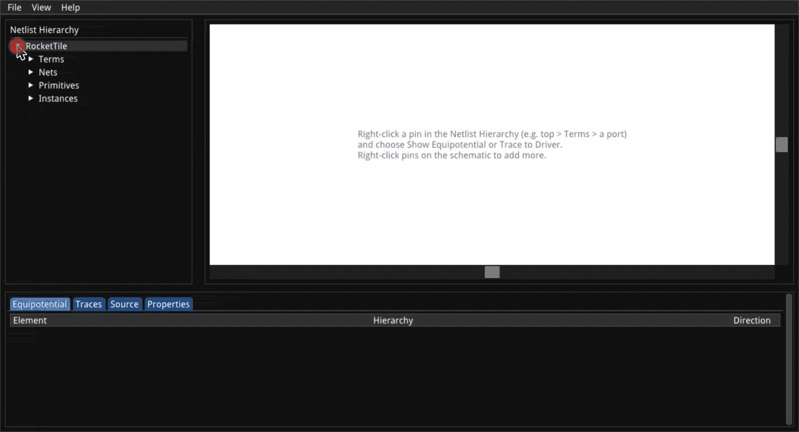

# naja-schematic

[](https://github.com/keplertech/naja-schematic/actions/workflows/native-macos.yml)
[](https://github.com/keplertech/naja-schematic/actions/workflows/native-linux.yml)
[](https://github.com/keplertech/naja-schematic/actions/workflows/emscripten.yml)
[](https://colab.research.google.com/github/keplertech/naja-schematic/blob/main/python/notebooks/getting_started.ipynb)

An interactive schematic viewer for netlists loaded with
[naja](https://github.com/najaeda/naja): browse the design hierarchy, trace
a signal back to its drivers, and jump from any gate to the source line it
came from. It runs as a desktop app (macOS, Linux), in a browser, or inside
a Jupyter/Colab/VSCode notebook.

> **Note:** This is a beta. Expect rough edges and breaking changes.



## Quick start

**In a notebook**: no install needed, [open the getting-started notebook
in Colab](https://colab.research.google.com/github/keplertech/naja-schematic/blob/main/python/notebooks/getting_started.ipynb),
then try [a real RISC-V core](https://colab.research.google.com/github/keplertech/naja-schematic/blob/main/python/notebooks/tinyrocket.ipynb).
Locally:

```bash
pip install naja-schematic
```

```python
from najaeda import netlist
import naja_schematic

netlist.load_liberty("cells.lib")
netlist.load_verilog("design.v")
naja_schematic.show()          # the viewer, in the cell output
```

**In a browser**, from a shell (same `pip install`):

```bash
naja-schematic --verilog design.v --liberty cells.lib --open
```

**As a desktop app**: [build it](#building-from-source), then:

```bash
naja-schematic-standalone design.v --liberty cells.lib
```

See the [Python package README](python/README.md) for the notebook API
(diagnosis overlays, selecting instances from code, embedding the viewer in
your own tool).

## Features

- **Schematic view** with real gate symbols (AND, OR, XOR, inverter,
  flip-flop, ...), taken from the cell's Liberty function, never guessed
  from its name. Modules are drawn as nested frames.
- **Trace to Driver**: the whole combinational fan-in cone of a pin, back
  to flip-flops and ports. Overlay several traces: each gets its own color,
  shared wires are striped and shared gates outlined.
- **Grow the schematic by hand**: start from any instance (right-click it
  in the design tree, then Show in Schematic), click an open pin to add its
  net, double-click a box to show all of its pins.
- **Design tree**, loaded lazily so large netlists open fast: instances,
  ports, nets and bus bits.
- **Show Sources**: where an instance, pin or net is declared and, for
  synthesized logic, the RTL it came from (e.g. Yosys `src` attributes),
  opened at the highlighted line.
- **Diagnosis overlay**: color and annotate flagged instances, pins and
  nets from a JSON report, e.g. from a formal equivalence check.
- **SVG export** of the schematic, from the File menu or headless from the
  command line.
- Loads gate-level Verilog (with Liberty), SystemVerilog, or naja SNL
  netlists.

## Command-line options

Both the desktop app and the `naja-schematic` browser server take a design
plus options, in any order. Their flags differ slightly:

| Desktop app (`naja-schematic-standalone`) | Browser server (`naja-schematic`) | What it does |
|---|---|---|
| `design.v` | `--verilog design.v` | Load a gate-level Verilog netlist |
| `design.sv` | `--sv a.sv b.sv --top top` | Load SystemVerilog (elaborated with slang) |
| | `--flist design.f`, `-D NAME=VALUE` | SystemVerilog command file, defines |
| `snl_dir/` | | Load a naja-if (SNL) netlist directory |
| `--liberty a.lib --liberty b.lib` | `--liberty a.lib b.lib` | Liberty cell libraries (Verilog only) |
| `--diagnosis report.json` | `--diagnosis report.json` | Show a diagnosis report on the design |
| `--yosys-src` | `--yosys-src` | Read Yosys `(* src *)` attributes, so Show Sources leads back to the RTL (Verilog only) |
| `--source-root dir` | `--source-root dir` | Where to look for relative source paths (repeatable) |
| `--source-map FROM=TO` | `--source-map FROM=TO` | Rewrite source paths recorded on another machine (repeatable) |
| | `--open` | Open the viewer in a browser |
| | `--port N`, `--host H` | Where to serve (default `localhost:8081`) |

Without a design, the desktop app starts empty: use the **File** menu (Open Verilog..., Open SystemVerilog..., Open naja-if...). A
diagnosis report can also be loaded later with **File > Load Diagnosis
JSON...**. `naja-schematic --help` lists every server option.

Source paths are looked up as recorded, then under each `--source-root` in
order, then in the current directory. `--source-map /home/ci/flow=/work/flow`
finds a file recorded as `/home/ci/flow/rtl/top.v` at
`/work/flow/rtl/top.v`.

### Headless SVG export

The desktop app can draw a schematic to an SVG file without opening a
window:

```bash
naja-schematic-standalone design.v --liberty cells.lib --export cone.svg \
  --trace '{"terminal": "y"}'
```

`--export out.svg` needs at least one of:

- `--trace '<pin>'` (repeatable): the fan-in cone of a pin.
- `--equipotential '<pin>'` (repeatable): one net.
- `--focus '["u1", "u2"]'`: one instance drawn alone, with all its pins.

A pin is `{"path": ["u1"], "terminal": "A", "bit": 0}`: `path` is the
instance that holds it (leave it out for a top-level port), `bit` is only
for buses.

## Controls

The same list is in the app under **Help > Keyboard Shortcuts**. "Ctrl" is
Cmd in the macOS desktop app (Ctrl in a browser, on any OS).

| Mouse on the schematic | Action |
|---|---|
| Wheel | Zoom about the cursor |
| Right or middle drag | Pan |
| Click an open (hollow) pin | Add its net to the schematic |
| Click a bus pin | Show its bits |
| Double-click a dashed box | Show all of its pins |
| Click a box | Select the instance (also in the design tree) |
| Click a wire | Select (highlight) its net |
| Click a box's hierarchy glyph | Show / hide what is inside it |
| Right-click | Menu: trace to driver, sources, properties, fit, clear |

| Keys (mouse over the schematic) | Action |
|---|---|
| `W` `A` `S` `D` | Pan up / left / down / right |
| `=` / `-` (hold) | Zoom in / out about the canvas center |
| `0` or Home | Fit the schematic to the canvas |

| Keys (anywhere) | Action |
|---|---|
| Ctrl `+` / Ctrl `-` | Zoom the schematic in / out |
| Ctrl `0` | Fit the schematic to the canvas |
| Ctrl `K` | Clear all nets from the schematic |

| Keys (Source tab, after clicking in the text) | Action |
|---|---|
| Ctrl `F` | Find in the shown file |
| Ctrl `G` | Find the next match |
| Ctrl `C` | Copy the selected text |
| Ctrl `A` | Select the whole file |

In a notebook or a VSCode webview, the viewer takes keys only while its
canvas has focus (click it first), and the host may keep some Ctrl chords
for itself.

**Open in Editor** (desktop app, Source tab) opens the file in your editor:
`$NAJA_SCHEMATIC_EDITOR` if set (`{file}`, `{line}` and `{col}` are filled
in, e.g. `subl {file}:{line}:{col}`), else VS Code, else the system's
default app. Edits there show up in the viewer only after the design is
loaded again; until then, the Source tab warns that the file changed.

## Building from source

Clone with submodules:

```bash
git clone --recursive https://github.com/keplertech/naja-schematic.git
# or, if already cloned without them:
git submodule update --init --recursive
```

### Desktop app (`naja-schematic-standalone`)

Needs SDL2 and OpenGL.

**macOS** (`brew install sdl2`), with the CMake presets:

```bash
cmake --preset native-debug      # or native-release
cmake --build --preset native-debug
../naja-schematic-build/native-debug/naja-schematic-standalone
```

The build directory is outside the repo, at `../naja-schematic-build/<preset>`.
The presets pin Apple Clang, so an Emscripten on `PATH` isn't picked up.

**Linux**: the package list is in
[`.github/workflows/native-linux.yml`](.github/workflows/native-linux.yml)
(SDL2, OpenGL, boost, capnproto, tbb, and `zenity` for file dialogs). Then:

```bash
cmake -S . -B build -G Ninja -DCMAKE_BUILD_TYPE=Debug
cmake --build build
build/naja-schematic-standalone
```

### Browser viewer

The browser viewer is the same C++ code built with
[Emscripten](https://emscripten.org/). It doesn't load netlists itself: it
asks a Python server (the `naja-schematic` package) over a WebSocket. To
work on the Python package with a locally built viewer, see
[python/README.md](python/README.md#development).

A standalone page, talking to a server on `ws://localhost:8081/ws`:

```bash
emcmake cmake -S . -B build-wasm
cmake --build build-wasm
python3 scripts/najaeda_server.py --verilog design.v --liberty cells.lib &
emrun --port 8080 build-wasm/naja-schematic.html
```

`scripts/najaeda_server.py` runs the `naja-schematic` server straight from
this source tree, without installing it.

## How it works

The desktop app and the browser viewer share all of their C++ code except
where the netlist comes from: the desktop app loads it in-process through
the naja C++ API, the browser viewer asks a Python server that uses
najaeda. Both speak the same JSON request/response protocol. A diagnosis
report is a message pushed to the viewer, which colors the netlist already
on screen.

[`CLAUDE.md`](CLAUDE.md) is the full architecture writeup, including the
protocol's message shapes; it is also the guide for AI coding agents
working in this repo.

## Reporting issues

If something breaks, crashes, or looks wrong, please
[file a GitHub issue](https://github.com/keplertech/naja-schematic/issues/new)
with the steps to reproduce, the netlist if you can share it, and any error
output:

- **Desktop app**: the terminal you started it from.
- **Browser or notebook**: the terminal (or notebook cell) running the
  server, where netlist errors show up, *and* the browser's JavaScript
  console (Cmd+Opt+J in Chrome, Cmd+Opt+K in Firefox; in VSCode, "Developer:
  Open Webview Developer Tools"), where viewer errors show up.

## License

Apache License 2.0 — see [LICENSE](LICENSE).
