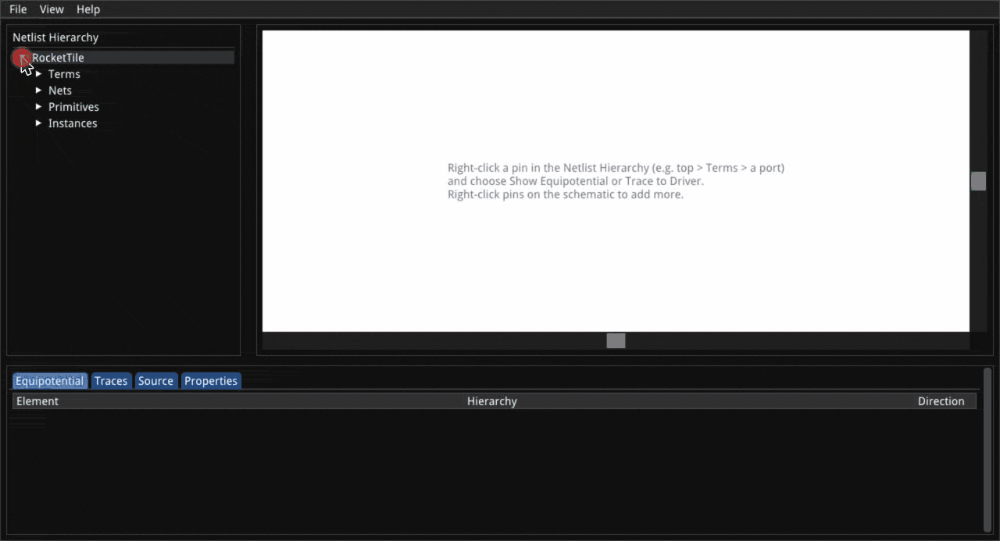

# naja-schematic (Python package)

Interactive schematic viewer for [najaeda](https://pypi.org/project/najaeda/)
netlists: the [naja-schematic](https://github.com/keplertech/naja-schematic)
WASM viewer, packaged with the Python backend that answers it from a live
najaeda netlist.



```bash
pip install naja-schematic
```

Mouse and keyboard controls are listed in the
[main README](https://github.com/keplertech/naja-schematic#controls) and in
the viewer under **Help > Keyboard Shortcuts**.

## In a notebook (Jupyter, Google Colab, VSCode)

[Try it in Colab](https://colab.research.google.com/github/keplertech/naja-schematic/blob/main/python/notebooks/getting_started.ipynb):
a walkthrough of every widget feature below, runnable as is. Then a real design: [a RISC-V core](https://colab.research.google.com/github/keplertech/naja-schematic/blob/main/python/notebooks/tinyrocket.ipynb).

```python
from najaeda import netlist
import naja_schematic

netlist.load_primitives("xilinx")
top = netlist.load_gate_level_verilog("design.v")

naja_schematic.show()          # interactive view in the cell output
```

The view is answered from the netlist in the running kernel, so it shows
the design as the notebook has built or edited it so far; call `show()`
again after an edit for a fresh view. Diagnoses (e.g. from a formal
equivalence check) can be overlaid:

```python
view = naja_schematic.show()
view.annotate([{"kind": "instance", "path": ["u_sub"], "severity": "error",
                "message": "not equivalent", "source": "kepler-formal"}])
view
```

The view and your najaeda code can point each other at instances.
`show_instance()` takes a najaeda `Instance` or a naja `SNLPath`, a list
of instance ids (as `Instance.pathIDs`) or a list of instance names (a plain string is one
name, never split on `/`, since escaped names can contain it). Anonymous
instances have no name to go by: reach them with an `Instance` or ids. The viewer opens its tree down to that instance, selects it, and
draws it alone in the schematic. Each pin there is open, so you can click
one to add its net and grow the schematic from the instance. In the other
direction, the instance selected in the viewer (click it in the tree or the
schematic) is available as a naja `SNLPath` (najaeda's raw API), and its
ids, which give the najaeda `Instance`, as `selected_id_path`:

```python
view.show_instance(netlist.get_instance_by_path(["u_sub", "u_and"]))
view.show_instance(["u_sub", "u_and"]) # same thing

view.show_net(netlist.get_instance_by_path(["u_sub", "u_and"]).get_term("O"),
              color="#ff8800")         # its net, as a colored trace
view.show_net((["u_sub"], "y"))        # (instance, terminal[, bit]) works too

path = view.selected                   # what the user clicked (an SNLPath), or None
path.getModel().getName()
inst = netlist.Instance(view.selected_id_path)

view.on_select(lambda path: print("selected", path))
```

`naja_schematic.show(inst)` (or `show(["u_sub", "u_and"])`) starts a new
view on it. After editing or reloading the design in later cells,
`view.design_changed()` refreshes an existing view in place.

## From a shell

```bash
naja-schematic --verilog design.v --liberty cells.lib --open
naja-schematic --sv top.sv --top top --diagnosis report.json --open
```

serves the viewer page and its WebSocket on `http://localhost:8081/` and
opens it in a browser. `--stdio` speaks the same protocol as JSON lines on
stdin/stdout instead, for a host (e.g. an editor extension) that relays
messages itself. `naja-schematic --help` lists every option.

`--py-primitives prims.py` (repeatable) loads primitives defined in
Python before the design: a `.py` file, or an importable module, whose
`load(db)` creates them on the design's `NLDB` (as
`najaeda.primitives.xilinx` does for `--xilinx`).

## SVG export, no browser

`export_svg()` draws part of the design loaded in najaeda as an SVG
schematic, with no browser and no display (e.g. in CI):

```python
import naja_schematic
from najaeda import netlist

top = netlist.load_gate_level_verilog("design.v")
naja_schematic.export_svg(
    [top.get_child_instance("u1")],                 # instances: boxes with every pin
    "cone.svg",
    nets=[top.get_term("y")],                       # nets, each a colored trace
    traces=[(["u1"], "D")],                         # fan-in cones, back to flops and ports
)
svgs = naja_schematic.export_svgs([                 # several drawings, one renderer
    {"instances": [["u1", "u2"]], "path": "u2.svg"},
    {"traces": [(["u3"], "A", 0)], "path": "u3_a0.svg"},
])
```

Targets are what `show_instance()`/`show_net()` take: najaeda
`Instance`/`Term`/`Net`/`Equipotential`, naja objects, instance paths as
lists of names or ids, and `(instance, terminal[, bit])` pins. One that
doesn't resolve raises `ValueError` and nothing is drawn. The drawing is
exactly what a viewer showing the same things exports, primitives defined
in Python included. From a shell:

```bash
naja-schematic render --verilog design.v --py-primitives prims.py --top top \
  --instance u1/u2 --net u1:A[3] --trace u3:D --net y --svg out.svg
```

`--instance`, `--net` and `--trace` are repeatable. A pin is `INST:TERM`,
`INST:TERM[BIT]`, or `TERM` for a top-level port; an instance path `u1/u2`
is matched against the design (an escaped name containing `/` still
works), or given as JSON (`'[3,7]'` ids, `'["u1","u2"]'` names; a pin as
`'{"id_path":[3,7],"terminal":"A","bit":0}'`). It exits non-zero, writing
nothing, if any target doesn't resolve.

The renderer, `naja-schematic-render`, is a small native program shipped in
the Linux x86_64 and macOS wheels. Elsewhere, build it from a checkout
(`cmake -S . -B build-render -DNAJA_SCHEMATIC_RENDER_ONLY=ON && cmake --build
build-render`, a C++ compiler is all it needs) and set
`NAJA_SCHEMATIC_RENDER` to its path.

## From an application that already holds the design

A tool that loads and edits the design itself (with najaeda or the raw
`naja` bindings) can serve the viewer on it without loading anything:

```python
import threading, naja_schematic

design_lock = threading.RLock()   # held by the host while it edits the design
server = naja_schematic.ViewerServer(lock=design_lock)   # port 0: any free port
server.start()
server.open_browser()             # or hand server.url to the user

server.annotate(items)            # diagnosis overlay, kept across reloads
server.show_instance([3, 7])      # instance ids, names, or a najaeda Instance
server.show_net(term, color="#ff8800")  # a net as a colored trace (a najaeda Term, ...)
svg = server.export_svg("view.svg")     # the schematic as SVG, from a viewer
server.show_net(term, trace=True)       # a pin's fan-in cone
server.on_select(lambda id_path, path: print("selected", path))
with server.replacing_design():   # holds design_lock, then viewers reload
    netlist.load_gate_level_verilog("other.v")
server.stop()
```

Viewer requests are answered on a background thread while `lock` is held
(or pass `run=` to answer them on a thread of your choosing). The page's
URL carries a random access token, and other web pages can't connect to
the WebSocket. Once the design is replaced, anything a viewer asked about
or selected in the old one is ignored, even if it arrives late or names
instance ids the new design reuses.

## Development

The viewer bundle (`naja_schematic/static/naja-schematic.js`) is built from
the C++ sources, not checked in. From the repository root:

```bash
emcmake cmake -S . -B build-wasm-module -DCMAKE_BUILD_TYPE=Release -DNAJA_SCHEMATIC_WASM_MODULE=ON
cmake --build build-wasm-module
export NAJA_SCHEMATIC_BUNDLE=$PWD/build-wasm-module/naja-schematic.js   # or copy it into static/
pip install -e "python[test]" && pytest python/tests
```

The SVG export tests need the headless renderer (they're skipped without
it):

```bash
cmake -S . -B build-render -DCMAKE_BUILD_TYPE=Release -DNAJA_SCHEMATIC_RENDER_ONLY=ON
cmake --build build-render
export NAJA_SCHEMATIC_RENDER=$PWD/build-render/naja-schematic-render   # or copy it into bin/
```

Releases are built and published by `.github/workflows/python-package.yml`
on a `v<version>` tag (e.g. `v0.1.0`).
